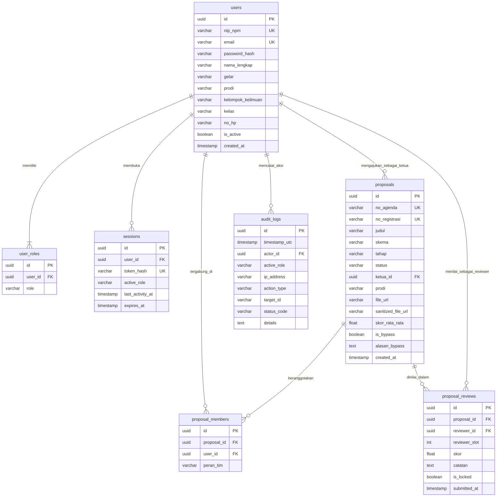

# Entity Relationship Diagram (ERD)
## Sistem Informasi Manajemen Penelitian dan Pengabdian kepada Masyarakat (SIM-PPM / PKM) — Politeknik Siber dan Sandi Negara

Dokumen ini merinci struktur relasi basis data sederhana untuk mendukung alur kerja Perdir Poltek SSN Nomor 1 Tahun 2025 serta kontrol keamanan **OWASP ASVS v5.0.0 Level 1**.

---

## 1. Diagram Relasi Entitas (Mermaid ERD)

---

## 2. Kamus Data dan Fungsi Entitas

| Entitas | Kolom Kunci & Atribut Utama | Fungsi Bisnis & Kontrol Keamanan OWASP Level 1 |
| :--- | :--- | :--- |
| **`users`** | `id` (PK), `nip_npm` (UK), `email` (UK), `password_hash`, `nama_lengkap`, `gelar`, `prodi`, `kelompok_keilmuan`, `kelas`, `no_hp`, `is_active`, `created_at` | Menyimpan identitas internal permanen (`id`), hash kata sandi (`bcrypt` atau `Argon2id`), atribut profil master untuk *auto-fill* formulir, serta status aktif akun untuk proses *offboarding*. |
| **`user_roles`** | `id` (PK), `user_id` (FK), `role` (`PENGUSUL`, `KAPRODI`, `KA_PPM`, `REVIEWER`, `DIREKTUR`, `ADMIN`) | Mendukung satu akun memiliki lebih dari satu peran sekaligus (*multi-role*) tanpa harus membuat akun terpisah. |
| **`sessions`** | `id` (PK), `user_id` (FK), `token_hash` (UK), `active_role`, `last_activity_at`, `expires_at` | Menyimpan konteks peran aktif (*Role Switcher*), menegakkan batas diam (*idle timeout* 30 menit), dan memutus seluruh sesi seketika saat pengguna *logout* atau akun dinonaktifkan. |
| **`proposals`** | `id` (PK), `no_agenda` (UK), `no_registrasi` (UK), `judul`, `skema`, `tahap`, `status`, `ketua_id` (FK), `prodi`, `file_url`, `sanitized_file_url`, `skor_rata_rata`, `is_bypass`, `alasan_bypass`, `created_at` | Menyimpan data usulan dan laporan, penomoran otomatis (`PL`, `OK-PK`, `OK-PP`, `OK-PKP`, `OK-PRP`), berkas bersih metadata untuk *blind review*, ambang batas revisi ($< 60$), serta jalur *bypass* Direktur. |
| **`proposal_members`** | `id` (PK), `proposal_id` (FK), `user_id` (FK), `peran_tim` | Menghubungkan anggota tim (Dosen, Taruna, atau Tendik) untuk *auto-fill* identitas serta validasi otomatis pencegahan konflik kepentingan penelaah. |
| **`proposal_reviews`** | `id` (PK), `proposal_id` (FK), `reviewer_id` (FK), `reviewer_slot` (1–3), `skor`, `catatan`, `is_locked`, `submitted_at` | Menyimpan penilaian terisolasi untuk Reviewer 1, 2, dan 3 agar skor tidak saling terlihat sebelum seluruh penelaah mengunci penilaian dan direkap oleh Ka. Pusat PPM. |
| **`audit_logs`** | `id` (PK), `timestamp_utc`, `actor_id` (FK), `active_role`, `ip_address`, `action_type`, `target_id`, `status_code`, `details` | Mencatat riwayat login, penolakan akses (`403`), validasi CPL, penilaian, *bypass* Direktur, dan perubahan peran secara tambah-saja (*append-only*) tanpa menyimpan kata sandi atau token sesi mentah. |

---

## 3. Aturan Relasi dan Penegakan Keamanan pada Skema

1. **Isolasi Data Berbasis Kueri (Anti-IDOR / BOLA)**:
   * **Pengusul** hanya dapat membaca dan memperbarui baris `proposals` di mana `ketua_id` sama dengan `user_id` pada sesi aktif (atau terdaftar di `proposal_members`).
   * **Kaprodi** hanya dapat membaca dan memvalidasi baris `proposals` dengan nilai `prodi` yang sesuai dengan program studinya.
   * **Reviewer** hanya dapat membaca dan menilai berkas yang memiliki relasi aktif pada `proposal_reviews.reviewer_id`.
2. **Pencegahan Konflik Kepentingan Otomatis**:
   * Sebelum menyisipkan baris baru ke `proposal_reviews`, server wajib memastikan `reviewer_id` tidak sama dengan `proposals.ketua_id` dan tidak terdaftar di `proposal_members` untuk `proposal_id` yang sama.
3. **Kontrol *Blind Review* dan Ambang Revisi ($< 60$)**:
   * Ketika `proposals.tahap = 'PROPOSAL'`, kueri API untuk peran `REVIEWER` hanya mengambil `sanitized_file_url` dan mengabaikan relasi `ketua_id` serta `proposal_members`. Identitas pengusul baru dibuka saat `tahap = 'LAPORAN'`.
   * Akses unggah ulang berkas revisi bagi `PENGUSUL` hanya dibuka oleh backend apabila nilai rata-rata penilaian memenuhi kondisi `skor_rata_rata` $< 60$.
4. **Perlindungan Kolom Sensitif (Anti-Mass Assignment)**:
   * Atribut sistem seperti `user_roles.role`, `proposals.status`, `proposals.no_registrasi`, `proposals.skor_rata_rata`, dan `proposals.is_bypass` tidak boleh diterima dari form umum dan hanya dapat diperbarui melalui *endpoint* khusus sesuai peran berwenang.